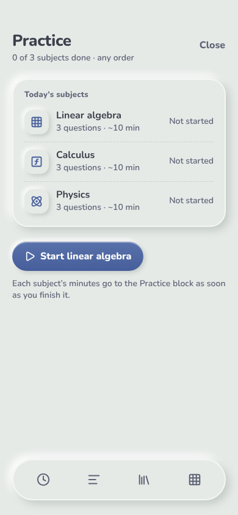
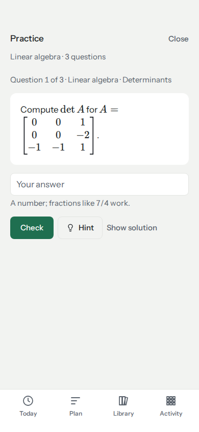
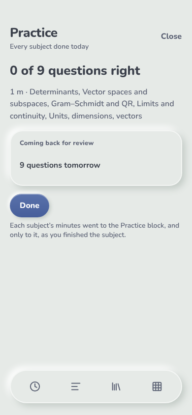

# Atlas

A local-first personal learning platform for one five-year plan (2026-09-21 to 2031-08-31). It answers
one question every morning: **what exactly do I do today?** By default that is an 8-hour day; the day can be
shaped to fit (see [Making it yours](#making-it-yours)).

No backend and no account. Everything you log is kept in your browser (IndexedDB), and with the optional
GitHub Sync also in a private repository you own, where each study session becomes a commit. Without it, the
app makes no network calls at all, and everything can still be exported to a single JSON file.

> Build status: see [PROGRESS.md](PROGRESS.md). Choices and assumptions: see [DECISIONS.md](DECISIONS.md).

<p>
  
  
  
  
</p>


The screenshots show eight weeks of made-up history. They are also the baselines of a screenshot test that CI runs
on every pull request. They are drawn on CI's Linux: after a change to the UI, commit an empty `screenshots/.redraw`
to the pull request's branch and CI redraws them all and pushes them back. (`npm run screenshots` redraws them on
your machine, to look at; fonts render a little differently on each system, so commit CI's.)

## Run it

Requires Node 22.18 or newer (the scripts use Node's built-in TypeScript support).

```bash
npm i
npm run dev
```

| Command | What it does |
|---|---|
| `npm run dev` | Dev server with hot reload; editing a file under `data/` reloads the app. |
| `npm run build` | `validate:data`, then typecheck, then the production build into `dist/`. |
| `npm test` | Unit tests (Vitest), run in UTC+5 on purpose. |
| `npm run test:e2e` | Builds, then runs the Playwright smoke tests against the production build. |
| `npm run validate:data` | Validates everything under `data/`. Fails on schema errors, duplicate ids, dangling references. |
| `npm run check:links` | Requests every URL in `data/` and prints a report. Never fails the build. |
| `npm run log:export` | Writes each logged day from a backup to `learning-log/YYYY/MM/DD.md` (see below). |
| `npm run screenshots` | Builds, then redraws the screenshots above from demo data, locally. The committed baselines are CI's: see above. |
| `npm run fetch:units` | Rebuilds the lecture and chapter checklists from the courses own syllabus pages. |
| `npm run test:sync -- --repo owner/name` | Runs GitHub Sync against the real GitHub, by hand (see below). Never in CI. |

## Making it yours

Atlas starts as the plan in `data/`: the same 8-hour day, every day. Real weeks are not like that, so the day,
the plan, the pace and the layout can all be changed from the app. Nothing new shows on the main screens until
you use it: every option sits behind an Edit or Change action in a sheet.

<p>
  
  
</p>

| You want to | Where |
|---|---|
| Make today a University day, give one block fewer minutes, skip a block, move it to tomorrow, swap two blocks' work, or rest | Today › the sliders icon (Change today) |
| Change the templates (Full day, University day, Weekend, Exam week, Rest day) or make your own | Settings › Schedule › Day templates |
| Give each weekday a template | Settings › Schedule › Weekly pattern |
| Give a date or a range another template ("Exam week 12–19 Dec") | Settings › Schedule › Date ranges |
| Add, rename, recolour or reorder blocks, or give one a track | Settings › Blocks |
| Count a day from 60 minutes or half its plan, whichever is lower | Settings › Heatmap and streak (both numbers are yours) |
| Light the heatmap by share of the day's plan, or by minutes | Settings › Heatmap and streak |
| Add a library item to the plan at a position | the item's sheet › Add to the plan |
| Reorder, swap for an alternative, or drop (and restore) an item | Plan › a lane › Edit |
| Rename or re-date a phase, change a lane's focus, add or split a phase | Plan › Edit plan › Phases |
| Set a goal with a date and see whether it is on track | Plan › Edit plan › Goals; it then shows on the Timeline |
| Undo a plan edit | the toast right after it, or Plan › Edit plan › Recent edits (the last 50) |
| Go relaxed, intense or a fixed number of minutes in one lane; pause it; catch up | Plan › a lane › Pace |
| Re-plan: push dates back, redistribute across lanes, or drop and defer the lowest-priority items | Plan › Re-plan (a preview first, always) |
| Hide parts of Today, compact rows, choose what Now picks | Settings › Layout › Today (with a live preview) |
| Choose 3 to 5 tabs and their order | Settings › Layout › Tabs |
| Plan's first view, dropped items shown or not | Settings › Layout › Plan |
| Theme, week start, 12- or 24-hour clock, density | Settings › Layout › General |
| Add a resource, project, paper or track of your own | Library › Add a resource |
| Move the practice period, or take three to five questions a subject | Settings › Practice |
| Turn the daily challenge off, or move the weekly slot to other days | Settings › Projects |

**Nothing is lost.** Your edits are kept apart from the curriculum, as an ordered list of patches in
`state/plan.json`, so an update to `data/` still flows in and your edits survive it. Dropped items stay
restorable, every plan edit can be undone, and a change to the schedule never rewrites a day already past: the
old templates are kept for the days they applied to. Schedule, pace and layout travel in `state/settings.json`.

## Daily practice

From 16 October 2026 to 31 January 2027 the day has a sixth block, **Practice** (P, 45 minutes): nine questions,
three each of linear algebra, calculus and physics, two new and one review once a review is due. Today's
Practice row ("1 of 3 subjects") opens a start screen with the three subjects and their status: not started,
2 of 3, done. Tap one to do its questions; after its last one you are back on the start screen. Do them in any
order, and separately across the day: a half-done subject resumes where it stopped. Once all three are done the
start screen shows the day's summary. The questions are the same on every device for that date, whatever the
order, and they do not change while you answer them.

<p>
  
  
  
</p>

- **Answering.** Numbers (with units where asked: `9.81 m/s^2`, `7/4`, `sqrt(2)/2`), vectors (`1, -2, 3`),
  matrices (`1 2; 3 4`), expressions (`2x sin(x)`), multiple choice, estimates within a factor, and proofs you
  grade yourself against the solution. A later part of a multi-part question that follows correctly from your own
  wrong earlier answer is marked right, and says so.
- **Hints and solutions.** Hints come one at a time. Showing the solution counts the question as missed.
- **Reviews.** A miss comes back after 1 day, then 3, 7, 21 and 60 as you get it right.
- **Difficulty** follows a rating per topic. Linear algebra follows the 18.06 lectures you have ticked; calculus
  and physics move to the next topic after 15 answers at 80 %.
- **Minutes**: each subject's time goes to the Practice block (math or physics) the moment you finish it, and
  nothing else gets it. The third subject marks the block done.
- **On demand**: Library › Practise a topic, ten questions on any topic, any day.
- **Activity › Practice** (once you have answered something): accuracy per subject and topic, the five weakest
  topics, reviews due, minutes.
- **Roadmaps**: a topic at 85 % over its last 20 answers ticks the roadmap.sh nodes it covers.
- **Settings › Practice**: the first and last day, three to five questions a subject, and an optional **Start
  with** subject, which the start screen offers first (it never fixes the order). After the last day the block
  disappears; the answers stay.

The questions live in `data/questions/` (format: `data/questions/SCHEMA.md`). Templates draw new numbers every
time. `npm run verify:questions` recomputes every answer with SymPy (`pip install sympy numpy`).

**Tech docs.** Every project that is not a weekly build has a tech doc in `data/projects/docs/<id>.md`: goal,
architecture, stack, milestones, how to measure and report it. Its milestones are checkboxes that count toward the
project's progress, and "Copy as README skeleton" starts the project's repository README from it. A catalogue build
shows its brief, approach (steps you can tick), done when, measure and pitfalls the same way.

The doc is one tap away: any project card or row opens it in a sheet, in the Deck (before Take it; the doc has Take
it too), the Library, Plan › Projects, the monthly queue and the weekly slot. On Today, the project's title on the
Now card, a quiet **Tech doc** next to Start and Log time, and a project's Later today row (with "Work on it now")
open it over Today. The timer keeps running, with its time in the sheet's header; ticks made in the doc show on the
card at once; closing it leaves Today as it was; and each doc reopens where you left it. Enter or Space opens a doc
from a focused row, Escape closes it and puts focus back. Challenges open their own screen instead.

<p>
  
</p>

## Projects: daily, weekly, monthly

Besides the curriculum's own projects, Atlas carries a catalogue of 920 in three tiers (`data/projects/*.jsonl`):

| Tier | What | Where it shows |
|---|---|---|
| Daily | 254 easy coding challenges, 30 topics | Block B: on its Now card, and mentioned on its row |
| Weekly | 112 medium challenges and 250 medium builds | Block D's weekly slot (the weekend by default): the week's challenge, and a build you take |
| Monthly | 304 advanced real cases | Block D's monthly queue, next to the plan's monthly projects |

<p>
  
  
  
</p>

- **The daily challenge** is picked for the date from the challenges not solved yet, a new topic after each solve, in
  the language of Block B's course. Skip gives another (three a day), Not today hides it, and Settings › Projects
  turns it off. Once all 254 are solved they come round again, to solve in another language. Its streak is its own.
- **A challenge** shows the statement, input and output, constraints and examples; hints one at a time; Show approach
  for the approach, complexity and edge cases; notes, a link to your solution, and Mark solved.
- **A build or a case** opens in a sheet. A case reads as a short tech doc whose milestones are checkboxes. Copy as
  README skeleton starts its repository; it is done only with the repository link filled in.
- **Finding one**: the Deck (Plan › Pick a project) by Daily, Weekly or Monthly, topic or domain, and This phase,
  Earlier or Everything; Library › Projects with search and filters for kind, difficulty, topic or domain, track,
  phase, level and hours; Activity › Projects for what is done per tier and domain and each topic's solve rate.

`npm run map:catalogue` fills each item's `refs` (courses) and `covers` (roadmap nodes) from the reviewed keyword
table in `scripts/lib/catalogue-mapping.ts`; CI checks the files match it.

## Keyboard

| Key | Does |
|---|---|
| `t` | Go to Today |
| `r` | Go to the Plan |
| `/` | Search: the page's own search box, or the Library's |
| `l` | Log time: opens the log form on Today, with the cursor in it |
| `?` | List the shortcuts |

They never fire while you type, or with Ctrl, Alt or Cmd held, and Settings > Keyboard turns them off, for
anyone using speech input. In the heatmap, Tab lands on one day, the arrow keys move by a day or a week, and
Enter opens it.

## Deploy

Pushing to `main` builds and deploys to GitHub Pages (`.github/workflows/deploy.yml`). One-time setup in
the repository: **Settings > Pages > Build and deployment > Source = "GitHub Actions"**.

The deploy checks itself (`scripts/live-check.ts`): before deploying, a browser opens the live site as a returning
user on the old build; after it, the app's update prompt must appear, Reload must bring in the new version (its
service-worker cache), and the main screens must render without an error. If not, the deploy run fails.

## GitHub Sync (optional)

Off until you connect it. With it on, a private GitHub repository is where your log and progress live, and the
browser keeps a copy that works offline. Clearing the browser or changing devices loses nothing, and every
study session is a commit on your contribution graph.

<p>
  
  
</p>

**Setting it up** (Settings > Sync):

1. [Create a private repository](https://github.com/new) named `atlas-data`. Leave it empty or add a README.
2. [Create a fine-grained personal access token](https://github.com/settings/personal-access-tokens/new):
   - Repository access: only select repositories, then `atlas-data`.
   - Permissions: Contents, read and write. Nothing else.
   - Expiration: 90 days.
3. Paste the repository (`your-name/atlas-data`) and the token into Settings > Sync, then Connect. Atlas checks
   both with GitHub, then runs the first sync. An empty repository gets a README and the whole layout. A
   repository another device already uses is merged with what this browser has.
4. Type the token's expiry date into "Token expires on". GitHub shows it on the token's page but does not let
   the app read it. Atlas reminds you two weeks before.

On another device, connect the same repository: the first sync brings everything over.

**What ends up in the repository.** Plain JSON and Markdown, readable on GitHub and editable by hand; the
README that Atlas writes into it explains each file.

| Path | What is in it |
|---|---|
| `state/items.json` | Status, ticked units, notes and links of every course, book, project, paper, certificate and milestone |
| `state/plan.json` | Your plan edits (an ordered list of patches, version 2), items of your own, re-plans and picked builds |
| `state/settings.json` | Blocks, day templates, the weekly pattern, date ranges, day changes, pace, pauses and layout (version 2). Never the token. |
| `state/practice.json` | Every practice answer: question, date, right or wrong, hints, time. Merged by answer, so two devices never lose one. |
| `state/challenges.json` | Catalogue challenges solved (and in which language), skipped or hidden for a day. Merged the same way. |
| `log/YYYY/MM/YYYY-MM-DD.json` and `.md` | One day, and its human-readable twin |
| `reviews/` | Weekly, monthly and quarterly reviews |
| `projects/` | Each project's write-up, links and checklist |
| `research/` | Your research reports. Atlas never writes here. |

**How it behaves.**

- Every change is saved in the browser first, so the app never waits for the network.
- Changes go to GitHub in one commit per sync: 3 seconds after a block or item is marked done, a timer stops or
  a review is saved; otherwise 60 seconds after the last change; and when you leave the page. Commit messages
  read like `log: 2026-10-07 · 8 h 10 m · 5/5 blocks`.
- Atlas checks GitHub when it opens and every 5 minutes while it is on screen.
- When two devices changed the same day, their entries are merged, and the later edit of each entry wins.
  Settings and plan edits keep the newer version, with a short notice.
- Offline, changes wait. Settings says how many ("Offline, 3 changes waiting"), and so does a quiet line at the
  foot of Today when they have been waiting a while. There are no banners.
- Commits are authored with your GitHub no-reply address, so they count on your graph; Settings can change it.
- **Disconnect** forgets the token and the repository, and keeps everything in the browser and on GitHub.
  **Reset everything**, with Sync on, clears only this browser; the next sync brings it back.

**The token** stays in this browser's IndexedDB. It is never exported, never written to either repository, and
sent only to `api.github.com`. Anyone who can use the device could read it, which is why it should reach only
this one repository and expire after 90 days. The calendar switch in Settings > Sync uses the same token to draw
your real GitHub contribution calendar under the Atlas heatmap on Activity.

**Checking it against the real GitHub.** `npm run test:sync` runs one full cycle with two in-memory devices:
connect, write, flush, a second device pulls, both edit the same day, merge. It works on a throwaway branch of a
repository you name, which it creates and deletes, and reads the token from the environment:

```bash
ATLAS_SYNC_TOKEN=github_pat_... npm run test:sync -- --repo your-name/atlas-sync-test
```

Use a throwaway repository with at least one commit, and a token for that repository only. `--fake` runs the
same cycle against the in-memory GitHub of the tests, and `--keep` leaves the branch for a look at its commits.

**Without Sync**, Settings says "Not backed up", once, and nowhere else. Export a file now and then (Settings >
Export everything). `npm run log:export` still turns a backup into a public Markdown learning log
(`learning-log/YYYY/MM/DD.md`, reflections left out unless you add `--reflections`).

## Editing the curriculum

Everything you study lives in `data/`, as YAML. Nothing about it is hard-coded in the app, and your logs,
statuses and notes reference items by id, so editing the curriculum never loses them.

| File | What is in it |
|---|---|
| `data/phases.yaml` | The six phases, and the focus of each lane in each |
| `data/plan.yaml` | Which item sits in which lane of which phase, in order |
| `data/resources/*.yaml` | Courses, books, lecture series and repositories |
| `data/units/*.yaml` | The lecture, chapter and lab checklist of one resource (the file name is its id) |
| `data/projects/*.yaml` | Capstones, monthly builds and the weekly mini-build pool |
| `data/papers.yaml`, `data/paper-sources.yaml` | The reading queue, and where to find more |
| `data/certs.yaml`, `data/subjects.yaml` | Certifications, and the credential map |
| `data/roadmaps.yaml` | The five roadmap.sh roadmaps, as sections of nodes, each section with the phase that teaches it |
| `data/settings.yaml` | The defaults a fresh install starts from |
| `data/questions/` | The practice bank: `topics.yaml`, then one file of questions per topic (`SCHEMA.md` describes them) |
| `data/projects/docs/*.md` | One tech doc per project (the file name is the project's id) |
| `data/projects/*.jsonl` | The project catalogue: daily easy challenges, weekly medium challenges and builds, monthly real cases, one per line |

### Adding a course, step by step

1. Describe it in the file of its track, for example `data/resources/math.yaml`:

   ```yaml
   - id: my-probability-book          # unique across resources, projects, papers and certs
     title: "A probability book you picked"
     provider: Its publisher
     type: book                        # course, lectures, book, tutorial, article, paper, repo or cert
     url: null                         # no link until you have opened it yourself...
     urlVerified: false
     searchHint: "the book's title and author"   # ...and meanwhile, what to search for
     tracks: [math]
     level: intro
     cost: paid
     estHours: 60
     prerequisites: [mit-18-06]        # never scheduled before these
     subject: math-physics             # its row in the credential map (data/subjects.yaml)
     summary: "Why it is on the list, in one sentence."
     short: "Probability"              # optional: the name lists show when the title is long
     covers: [ai-engineer/embeddings]  # optional: roadmap.sh nodes it ticks when done
   ```

   Once you have opened the page, set `url`, `urlVerified: true` and `lastVerified` to that day.

2. Put it on the roadmap: add `- { resource: my-probability-book }` to a lane of a phase in
   `data/plan.yaml`. The order of the list is the order of the lane. To spread one item over two lanes or
   two years (a book begun in year 2 and finished in year 3), list it in both places with `hours:` on each.
   For part of a course ("selected lectures"), one entry with `hours:` is enough.

3. If it has chapters or lectures to tick off, list them in `data/units/my-probability-book.yaml`:

   ```yaml
   - { id: ch-1, title: "Chapter 1: Counting" }
   - { id: ch-2, title: "Chapter 2: Conditional probability" }
   ```

   Progress is stored against these ids, so rename titles freely but keep the ids.

4. Run `npm run validate:data`, then `npm run dev` to see it.

A project works the same way in `data/projects/*.yaml`, with acceptance criteria instead of units. Anything
you would rather not put in a file can be added from the app instead (Library > Add a resource, or Plan > a
lane > Edit > "Add to this lane"); those additions live in your browser and travel in backups.

A roadmap.sh node's id is the slug of its label in `data/roadmaps.yaml`: "Ops:Byte Ratio" is
`ops-byte-ratio`. An item that `covers` a node ticks it on Plan > Credentials > Roadmaps once the item is done.
Nodes marked `optional: true` (vendor-specific or engine-specific ones) are left out of the coverage percent.

After an edit, run `npm run validate:data`. It fails on a schema error, a duplicate id, a dangling
reference, a prerequisite cycle, an item planned before its prerequisite, or a roadmap item with no row in
the credential map. Two rules are worth knowing up front:

- **ids must be unique across resources, projects, papers and certs**, because a log entry references them
  without saying which kind it means;
- **a `covers` entry must name a real node**, written `roadmap-id/node-id`;
- **a URL is either verified or absent.** Set `url: null` with a `searchHint` rather than writing down a
  link you have not opened; the app then shows the item with a "find link" badge.
