#  Atlas

A local-first personal learning platform for one five-year plan (2026-09-21 to 2031-08-31). It answers
one question every morning: **what exactly do I do today?** By default that is a fixed 10-hour day (see
[The daily schedule](#the-daily-schedule)); the day can be shaped to fit (see [Making it yours](#making-it-yours)).

No backend and no account. Everything you log is kept in your browser (IndexedDB), and with the optional
GitHub Sync also in a private repository you own, where each study session becomes a commit. Without it, the
app makes no network calls at all, and everything can still be exported to a single JSON file.

> Build status: see [PROGRESS.md](PROGRESS.md). Choices and assumptions: see [DECISIONS.md](DECISIONS.md).

<p>
  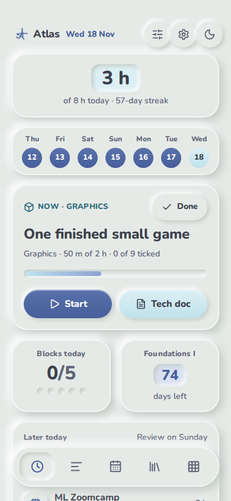
  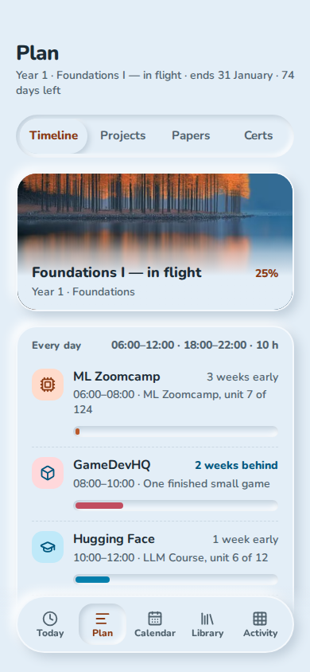
  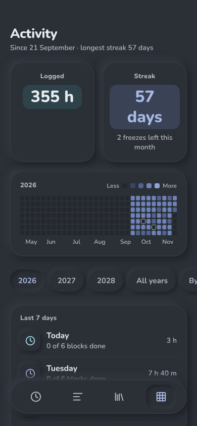
  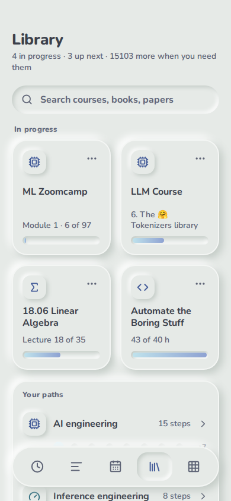
</p>

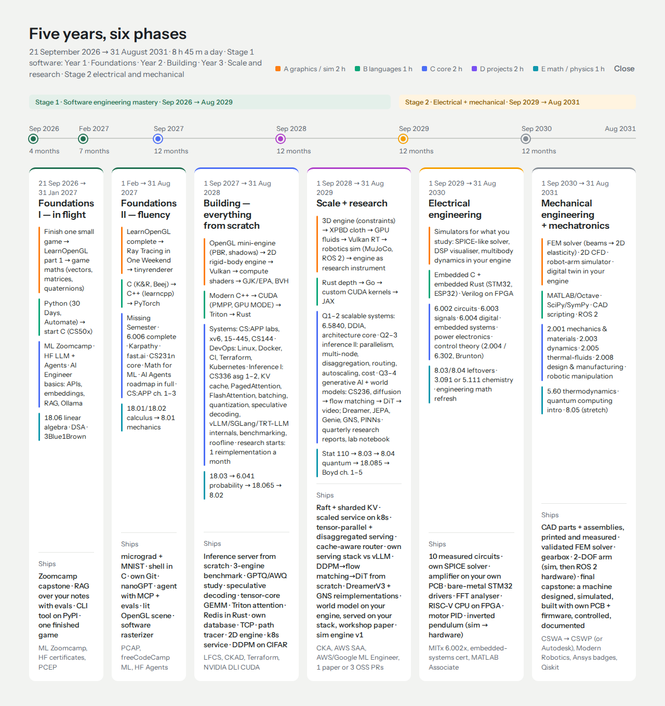

The look is soft clay: one calm background, raised tiles, sunken wells, and only blue and ice. Each block has its own
icon on Today; subjects, kinds of project and their status have theirs too, always next to a word that says the same
(the style guide is [docs/CLAY-STYLE.md](docs/CLAY-STYLE.md), the icon map and the choices made on it are in
[DECISIONS.md](DECISIONS.md), the boards in [docs/mockups](docs/mockups)). No scrollbar is drawn anywhere: a strip that
scrolls sideways opens at its latest item and fades at the edge where more is hidden.

The screenshots show eight weeks of made-up history. They are also the baselines of a screenshot test that CI runs
on every pull request. They are drawn on CI's Linux: after a change to the UI, commit an empty `screenshots/.redraw`
to the pull request's branch and CI redraws them all and pushes them back. (`npm run screenshots` redraws them on
your machine, to look at; fonts render a little differently on each system, so commit CI's.)

## Run it

Requires Node 22.18 or newer (the scripts use Node's built-in TypeScript support).

```bash
npm i
npm run dev
```

| Command | What it does |
|---|---|
| `npm run dev` | Dev server with hot reload; editing a file under `data/` reloads the app. |
| `npm run build` | `validate:data`, then typecheck, then the production build into `dist/`. |
| `npm test` | Unit tests (Vitest), run in UTC+5 on purpose. |
| `npm run test:e2e` | Builds, then runs the Playwright smoke tests against the production build. |
| `npm run validate:data` | Validates everything under `data/`. Fails on schema errors, duplicate ids, dangling references. |
| `npm run check:links` | Requests every URL in `data/` and prints a report. Never fails the build. |
| `npm run log:export` | Writes each logged day from a backup to `learning-log/YYYY/MM/DD.md` (see below). |
| `npm run screenshots` | Builds, then redraws the screenshots above from demo data, locally. The committed baselines are CI's: see above. |
| `npm run fetch:units` | Rebuilds the lecture and chapter checklists from the courses own syllabus pages. |
| `npm run test:sync -- --repo owner/name` | Runs GitHub Sync against the real GitHub, by hand (see below). Never in CI. |

## The daily schedule

Every day is the same five two-hour courses at fixed times, 10 hours in all:

| Time | Block | Works on first |
|---|---|---|
| 06:00 to 08:00 | C · ML Zoomcamp | ML Zoomcamp, then the next item of lane C |
| 08:00 to 10:00 | A · GameDevHQ | the GameDevHQ Unity course, then the small game that closes it |
| 10:00 to 12:00 | H · Hugging Face | the Hugging Face LLM Course, then the Agents course and the AI-engineer basics |
| 12:00 to 18:00 | Break | |
| 18:00 to 20:00 | B · Coding lessons | 30 Days of Python, with the daily challenge |
| 20:00 to 22:00 | E · Math and physics | MIT 18.06, then the rest of lane E |

- **Now follows the clock.** At 08:40 Today's Now is GameDevHQ ("Now · 08:00–10:00"); between 12:00 and 18:00 it is
  the break, with Coding lessons next (a tap starts it early); after 22:00 the day is done. A block tapped in Later
  today, or the one whose timer runs, comes first. Later today lists the blocks still to come with their windows
  ("10:00–12:00"), by session around the break, and counts what is done ("2 of 5 done"). A block whose window passed
  unfinished waits under "Earlier · not finished" with the time it got, still a tap away; the done ones fold into
  "Done today".
- **When a block's time is up** and its timer still runs (08:00, 10:00, 20:00, 22:00), Today asks quietly: Switch
  (or Stop at 22:00) or Keep going. No notifications: a web app cannot ring reliably while closed.
- **Pinned courses.** The first course of each lane is the one above; when it is done, the lane moves on by itself.
- **Projects (block D)** are no longer in the day. The Deck, the catalogue, Plan › Projects and the Library still
  hold them; add Projects to a day in Calendar when you want one.
- **Change it:** Calendar › a block › Apply to every day (from today on), or Settings › Schedule. Settings ›
  Schedule › Reset to the daily schedule goes back to the table above from today. Days already past keep the plan
  they had.
- **Settings from before** (no block H) switch once, the first time this version opens: the days up to yesterday
  keep their old plan, your day changes, busy times, pace and logged time stay. `npm run schedule:shift` lists the
  items whose projected finish moved by more than two weeks (`docs/daily-schedule/pace-shift.txt`).

## The daily blog

The day's post is written in your own blog, through Pages CMS, never in Atlas. Atlas helps with the rest:

- **A reminder.** Once the day's last block is marked done or its timer stopped, or at 22:00, Today shows "Write
  today's blog post" at the top of Later today. The row at the end of the list says "Blog post · not yet" or
  "posted ✓". No pop-ups, no notifications.
- **Today's blog post** (from that row, the Day done card, or Blog on any past day in Calendar): "Sun 18 Oct · day
  28" counted from 21 September 2026, the writing streak, what you did block by block with the time and what you
  ticked, and a Markdown outline built from it (a heading per block, the ticks as bullets, "What I learned:" and
  "Stuck on:" to fill in). **Copy outline** copies it.
- **Open my blog** opens Pages CMS in a new tab. Paste your posts collection's own link in Settings › Blog › Editor
  link to land straight on it.
- **I posted it** marks the day (Undo takes it back) and feeds the writing streak. A day with no study and no post
  neither counts nor breaks it. The mark syncs as `blog/<date>.json`: `{ "posted": true, "at": "…" }`.
- **Detect my post automatically** (Settings › Blog, off by default): once an evening, from 21:00, and when the blog
  screen opens, Atlas lists the blog repository's `_posts` folder and marks the day when a post dated that day is
  there. Read-only: it never writes to the blog. If the token cannot read the repository, the setting says how to
  give it Contents: Read-only, and stays off.

## Lesson checklists

A resource can carry a lesson checklist: `data/units/<id>.json` lists its modules and, in each, its videos,
readings, homework and projects, with their links. ML Zoomcamp has one (`data/units/ml-zoomcamp.json`, from
DataTalksClub's repository and its YouTube playlist).

- **On Today** the Now card says "Module 1 · 6 of 97 videos done" (optional and outdated lessons do not count), the
  bar shows the course's progress, and the list shows the current module: the lessons done just before, struck
  through, the current one marked NOW, and the rest with the homework. A tick marks a lesson done and moves NOW on;
  the last one of a module brings the next. Each tick can be undone from the toast, and the timer is not touched.
- **Play** knobs open a video in its place in the playlist, in a new tab; the second button plays the current one
  ("Play 1.7"). A title opens its notes, homework or project page on GitHub.
- **Show all modules** opens the whole list by module; optional lessons fold under "Optional". The Library's sheet
  for the course shows the same list and its progress.
- **The pace** counts 15 minutes a video, the homework and project hours the file gives (else 2 h and 20 h), and half
  an hour for anything else. Ticks sync like every other item state, and show in the day's blog outline.

The items marked `"status": "done"` in the file (where you were when it was written) are ticked once on each
device, never over a tick already there. `npm run validate:data` checks the ids, the links, and that every video is in the playlist.

## Sleep

A phone app cannot see you sleep, so Atlas asks: a bedtime and a wake time, by hand.

- **In the morning** Today asks "How did you sleep?" with **Log sleep**, until it is logged or 12:00. It never blocks
  anything, and Settings › Sleep turns it off.
- **The Sleep screen** (from that row, the **Slept** tile on Today, or Activity) shows the night's length, live, with
  Bedtime and Woke up: − and + move 15 minutes, a tap on the time types it. It starts from your usual bedtime (23:00 at
  first) and, in the morning, from now. **Save** keeps one night per wake-up date; saving again replaces it. A night
  under an hour or over 16 hours asks "Are you sure?" first.
- Under it: **This week** (bars scaled to 9 hours, a dashed line at the goal, the average), **Usual bedtime** (the
  median of the last 7 nights), the bedtime that gives the goal before the first block ("For 8 h by 06:00 · 22:00"),
  and the last 30 nights, any of which opens to edit.
- **Activity** has a Sleep tile: the last 7 nights' average and 30 nights as a strip. Sleep is not study: it takes no
  part in the streak or the heatmap.
- **Settings › Sleep**: the goal (6 to 10 h, 8 h at first) and the morning question.
- A night syncs as `sleep/<wake date>.json`: `{ "bed": "2026-10-17T23:00", "wake": "2026-10-18T05:40", "minutes": 400 }`,
  local times; the newer edit wins.

## Internships

An internship goal is a file, `data/internships.json` (one more goal is one more `data/internships-<name>.json`): the
company's roles in the order to apply, the phases with the gate to tick before the next, the projects that prove the
fit, the open-source plans, what the interviews cover, the resume checklist and the questions for the recruiter.
`npm run validate:data` checks it: unique ids, every resource it names in the Library (or a paper of the reading
queue), ISO dates, a fit of strong, medium or stretch.

- **Plan › Next** has a row per goal ("Internships · NVIDIA 2027", the next role, the days to apply, the gate's
  count); **Today** shows a card while a role has an upcoming apply date: the role and the days, the gate and the
  phase's week, the one thing for today in the Intern Prep block, **Open** and **Checklist**.
- **Targets**: the next application with the gate to apply and **Open roadmap**; the roles in order with their fit
  (a tap opens the note, the evidence and **Mark applied**); the phases with the current one marked; open source.
- **Roadmap**: a phase at a time; its gate as checkboxes with the count and the bar; the next phase says it is
  locked until the gate is done, but opens; the weeks; **From your library**, the items the phase names with their
  status, a tap opening the sheet.
- **Projects**: code, title, roles, phase and duration; a tap on the status moves it on (later, next, building,
  done); a building project has a bar with − and +; Proves and Done when.
- **Prep**: the interview areas with a confidence of three dots (a tap moves it on; "ready" is three), the resume
  checklist and the questions for the recruiter.
- Ticks, ratings and statuses stay on this device, by the file's ids, and go into every backup; the file is never
  written. They do not sync between devices yet.

## Making it yours

Atlas starts as the plan in `data/`: the same 10-hour day, every day. Real weeks are not like that, so the day,
the plan, the pace and the layout can all be changed from the app. Nothing new shows on the main screens until
you use it: every option sits behind an Edit or Change action in a sheet.

<p>
  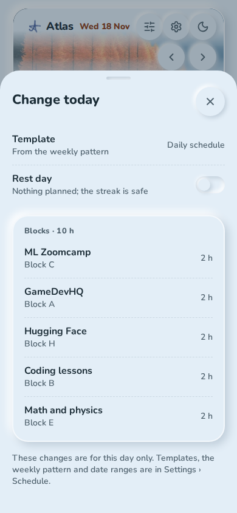
  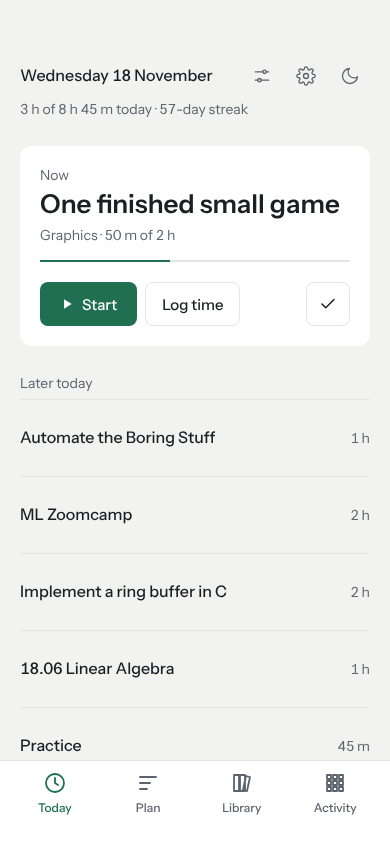
</p>

| You want to | Where |
|---|---|
| Make today a University day, give one block fewer minutes, skip a block, move it to tomorrow, swap two blocks' work, or rest | Today › the sliders icon (Change today) |
| Change the templates (Daily schedule, University day, Weekend, Exam week, Rest day) or make your own | Settings › Schedule › Day templates |
| Give each weekday a template | Settings › Schedule › Weekly pattern |
| Give a date or a range another template ("Exam week 12–19 Dec") | Settings › Schedule › Date ranges |
| Add, rename, recolour or reorder blocks, or give one a track | Settings › Blocks |
| Count a day from 60 minutes or half its plan, whichever is lower | Settings › Heatmap and streak (both numbers are yours) |
| Light the heatmap by share of the day's plan, or by minutes | Settings › Heatmap and streak |
| Add a library item to the plan at a position | the item's sheet › Add to the plan |
| Reorder, swap for an alternative, or drop (and restore) an item | Plan › a lane › Edit |
| Rename or re-date a phase, change a lane's focus, add or split a phase | Plan › Edit plan › Phases |
| Set a goal with a date and see whether it is on track | Plan › Edit plan › Goals; it then shows on the Timeline |
| Undo a plan edit | the toast right after it, or Plan › Edit plan › Recent edits (the last 50) |
| Go relaxed, intense or a fixed number of minutes in one lane; pause it; catch up | Plan › a lane › Pace |
| Re-plan: push dates back, redistribute across lanes, or drop and defer the lowest-priority items | Plan › Re-plan (a preview first, always) |
| Hide parts of Today, compact rows, choose what Now picks | Settings › Layout › Today (with a live preview) |
| Choose 3 to 5 tabs and their order | Settings › Layout › Tabs |
| Plan's first view, dropped items shown or not | Settings › Layout › Plan |
| Theme, week start, 12- or 24-hour clock, density | Settings › Layout › General |
| Add a resource, project, paper or track of your own | Library › a shelf › Add a resource |
| Turn the daily challenge off, or move the weekly slot to other days | Settings › Projects |

**Nothing is lost.** Your edits are kept apart from the curriculum, as an ordered list of patches in
`state/plan.json`, so an update to `data/` still flows in and your edits survive it. Dropped items stay
restorable, every plan edit can be undone, and a change to the schedule never rewrites a day already past: the
old templates are kept for the days they applied to. Schedule, pace and layout travel in `state/settings.json`.

## The Library

The Library opens on what matters now, not on all of it:

- **In progress**: what is started (at most six cards), each with how far it is ("Module 6 of 10") and a menu to
  Pause (back to not started; its progress stays) or Mark done. A long press on a card opens the same menu.
- **Your paths**: the plan's courses and books in plan order, one path per group of tracks (AI engineering,
  Inference engineering, Languages, Graphics, Simulation, Math and physics, Systems; Electrical, mechanical & aerospace,
  which gathers electrical, embedded, mechanical and aerospace, and Robotics wait under "Later in the plan" until they come within a year). Each shows a subway line of
  at most eight stops and "+N", and its next step. A path opens on its own page, grouped by phase, its current step
  marked; a path that follows roadmap.sh roadmaps (AI engineering, Inference engineering, Software architecture,
  Graphics) opens with their official pages. Alternatives, the Library's other resources of its tracks and roadmaps
  and the papers of its tracks wait under "Optional for this path", forty at a time. Software architecture and DevOps
  have nothing on the plan yet: they are listed as "Not on the plan · N to browse" and open on that list. **Research**
  lists year 3's reading by area (Inference, World models, Diffusion, Generative AI), papers first, the foundations
  before the frontier.
- **Up next**: the three nearest steps not started, across every path; steps the plan reaches together go by priority.
- **Browse when you need something**: shelves for Courses, Books, Papers, Articles, Blogs to follow, Tools,
  Practice (exercises, puzzles and problem sets) and Projects, with their real counts. A shelf is the full list
  (windowed, so a few hundred rows stay quick on a phone) with search and the Active, Not started, Done and Track
  filters, and it is where you add a resource of your own. Every shelf but Projects, and search, also filter by Level
  (Beginner, Intermediate, Advanced) and by roadmap.sh Roadmap, and every list reads in the plan's order: priority
  for years 1 to 3 (1 inference and the AI feeding it, 2 architecture, systems, languages and DevOps, 3 graphics,
  simulation and robotics, 4 game development), then the year it fits, then level. A resource's sheet says how it fits
  the plan and has **Write log entry**, which opens the day's blog post with the outline started on that resource.

Searching shows the matches grouped by shelf, three of each, with "Show all" to open that shelf on the same search.
Every planned resource has a short title (28 characters at most, checked by `npm run validate:data`) so cards and
paths stay one line.

Beyond the plan, `data/resources/library-additions.yaml` holds about a hundred free courses, books, docs and practice
sites to reach for when you need them (RESOURCES-ADD). They are not in any lane: each says the year it fits from
(`fromYear`), may name a resource worth doing first (`after`, a soft prerequisite the schedule never enforces, or
`doFirst` in words), and a sheet shows how it is free ("free to audit", "Free tier") and when its link was checked.
A second set, `data/resources/library-more.yaml` (MORE-RESOURCES), adds close to four hundred papers, blogs,
articles, books, courses, docs and practice across AI, inference, systems, software architecture (a track of its own)
and robotics; papers the reading queue already had took only their missing fields (a short name, why, a level, a year).
The whole Atlas Library (ATLAS-LIBRARY) came next: 2,408 rows upserted by id, 1,682 of them new, in
`data/resources/library-atlas.yaml`, each with its priority, its roadmap.sh roadmap and its year 3 research area
(`docs/imports-atlas-library.md` lists every merge and update). Its second file (3,386 rows) added 928 more,
among them math and physics and electrical and mechanical engineering, in `data/resources/library-atlas-2.yaml`
(`docs/imports-atlas-library-2.md`), and its third (3,811 rows) 418 more, among them hardware and chip design and
quantum computing, in `data/resources/library-atlas-3.yaml` (`docs/imports-atlas-library-3.md`). Its harness
additions (226 rows on agent harnesses, evaluation and self-improving agents) are in
`data/resources/library-harness.yaml` (`docs/imports-atlas-harness.md`), and its whole, 10,436-row file adds 6,388
more in `data/resources/library-atlas-4.yaml` (`docs/imports-atlas-library-4.md`), and its 11,389-row file 954 more,
many of them blogs, in `data/resources/library-atlas-5.yaml` (`docs/imports-atlas-library-5.md`), and its 12,744-row
file 1,349 more (developer essentials and a gap fill) in `data/resources/library-atlas-6.yaml`
(`docs/imports-atlas-library-6.md`), and its 13,839-row file 1,094 more, nearly all of them electrical, mechanical,
nuclear, chemical and aerospace engineering, in `data/resources/library-atlas-7.yaml`
(`docs/imports-atlas-library-7.md`), and its 14,547-row file 708 more, the energy and extreme physics cluster, in
`data/resources/library-atlas-8.yaml` (`docs/imports-atlas-library-8.md`), and its 15,104-row file 557 more, the cyber
defence cluster, tagged `security`, in `data/resources/library-atlas-9.yaml` (`docs/imports-atlas-library-9.md`):
15,110 resources in all, and every track has blogs, so the Blogs shelf filters by track like the others. "Developer essentials", a row under the shelves, gathers the resources whose title or tags
name the terminal, Git, Linux, SQL, Postgres or the web (HTML, CSS, JavaScript, TypeScript, React, HTTP) from every
shelf, with the shelves' chips, and "Compact power & energy conversion" the fusion, direct conversion, superconductor,
pulsed power and plasma rows of the engineering, simulation, math and hardware tracks, and "Security & defence" the
cyber defence rows (tagged `security`, plus the older rows its words find), with chips for its seven areas. The
Electrical, mechanical & aerospace path has chips for its areas (Mechanics, Materials, Thermo-fluids, Design & CAD, Manufacturing, Electronics
& PCB, Power & energy, Control, Aerospace, Chemical & nuclear, Practice), read from each row's title and summary.
About 14,750 of them only ever appear in the Library; they ride in a chunk of their
own that loads once the first screen has its plan and the browser is idle, so Today starts as fast as before.
A weekly job (`.github/workflows/links.yml`) runs `npm run check:links` and reports; it never edits the data.
`npm run check:links -- --checked 2026-10-19` checks only the links an import dated that day, and `--in <file>` only
the rows one data file defines. A link opened by hand is marked `linkCheck: manual-ok` and not requested; the
addresses and the hosts that turn scripts away are in `scripts/lib/link-policy.ts`.

<p>
  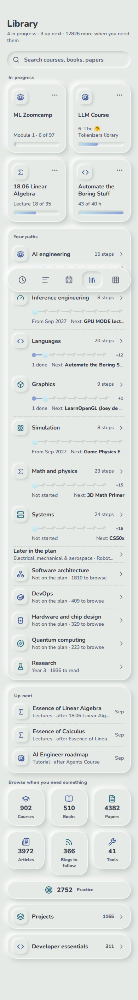
  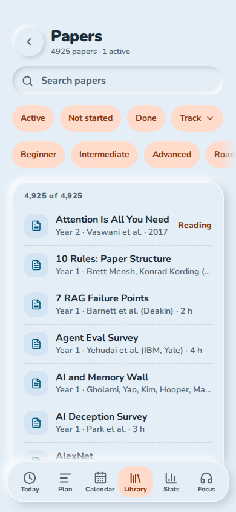
  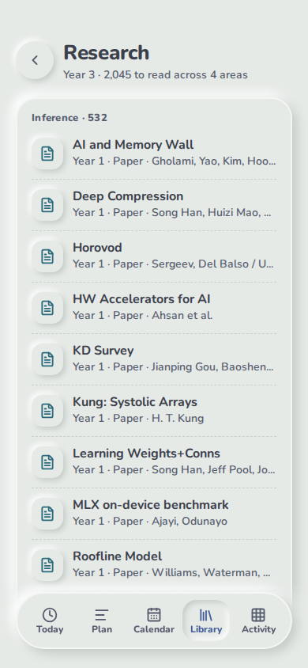
  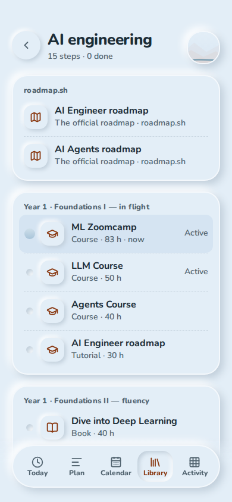
  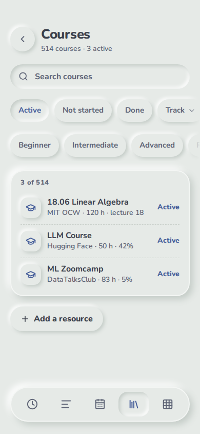
  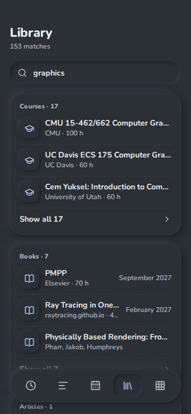
</p>

## Calendar and the timer

**Calendar** (the tab between Plan and Library) is where the plan's days are seen and changed, like a calendar app.

<p>
  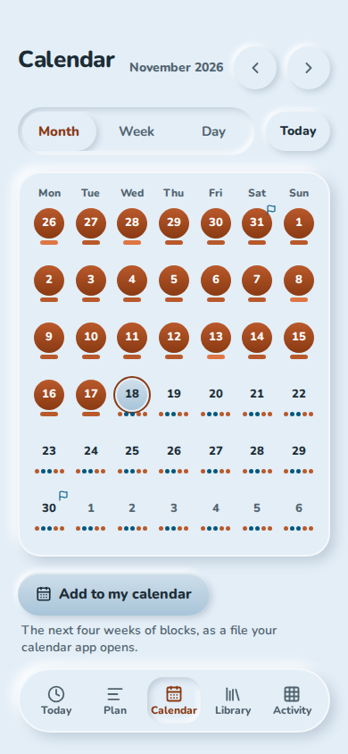
  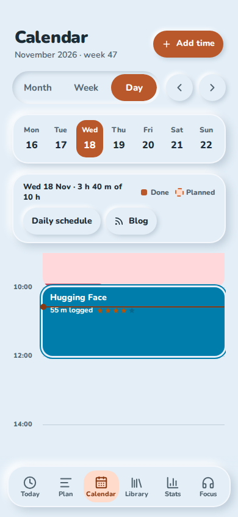
  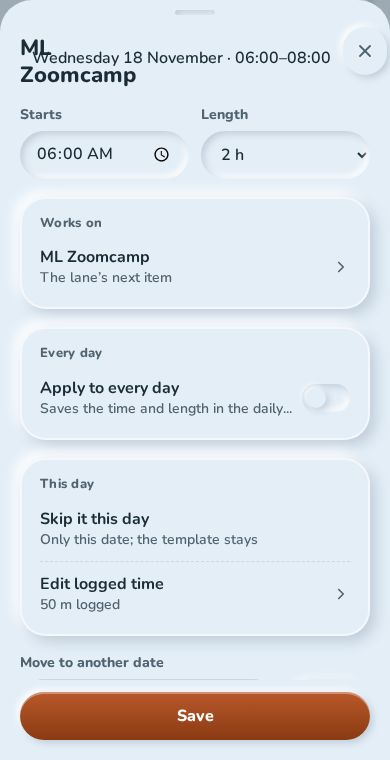
</p>

- **Month**: a grid from your week's first day. A past day that counted is blue and has a small pill in the
  heatmap's colour for the time logged; a day that should have had time and has none is pressed in; today is ice.
  Future days show a dot per planned block, a short label on another template ("Uni", "Exam", "Rest"), and a flag
  for a phase start, a goal or a monthly project due. Arrows or a swipe change the month; **Today** comes back.
- **Day** (tap a date): a time grid from 06:00 to 24:00 with the current time on today. Each block sits at its time
  with its icon, name, item and length; time already logged fills it, time still to come is pressed in. Blocks
  follow each other from 08:00 with 15-minute breaks unless a template (Settings › Schedule) or the date gives
  them a start time.
  - **Drag** a block to move it, **drag its bottom edge** to change its length (15-minute steps; on a phone, press
    and hold first). Every change has **Undo**.
  - **Tap a block** for its sheet: start time, length, which item it works on, skip it, move it to another date,
    or **Apply to every Monday** (or whichever weekday) to write it into the template instead of this date.
  - **Tap an empty slot** (or **Add**) to add a block, a **busy** event (a class, once or every week) or a rest
    day. Blocks never overlap busy time: they move to after it, and a block dropped onto it asks to shift it and
    the blocks after it.
  - The header shows the day's template (tap to switch) and planned against logged time.
- **Week**: seven narrow columns ("M 19", today in ice), with the same moves. Events are filled in their block's
  colour with its icon and, when there is room, a short label (ML, GD, HF, Code, Math).
- On a phone (narrower than 600 px) Calendar opens on the day; the grid starts at the day's first block (or around
  the current time on today), at 56 px an hour.
- **Add to my calendar** downloads the next four weeks of blocks as an `.ics` file.

Changes to one date are that date's own change (as Change today makes); "every weekday" changes the template. Both
sync with your settings. Nothing in Calendar logs minutes, and Today shows its blocks in the order of their times.

**The timer is how time is logged.** Start on Today's Now card; it stores when it started, so it keeps counting
through a reload, a closed tab or a locked phone. The big counter shows the block's **total for today**, so Stop
then Start carries on from it, and the header reads "Running · since 08:12 · 47 m on this block today". One runs
at a time: starting another block stops the first and saves its minutes, and coming back to it continues from its
total. Nothing is rounded away: a stop logs whole minutes and keeps the leftover seconds for the next session on
the same block, so many short sessions add up. Durations read "12 m" and "1 h 05 m"; a block counts as done in
Blocks today once its time reaches its target. A timer left running is caught the next time Atlas opens, after three hours or past midnight:
"Still working on Core? You started at 14:10" with **Keep**, **Stop at** the last time the app was used, or
**Stop now**. A timer that ran past midnight logs each part on its own day. To correct a mistake, open the day in
Calendar, tap the block and choose **Edit logged time**: the one place minutes can be entered by hand.

## Tech docs

A project's tech doc shows how the thing works, not only what it is. Every monthly case, every weekly build (a
lighter doc) and every plan project with a doc has a **design** in `data/projects/design/<id>.yaml`:

- what you'll build, in two to four plain sentences
- what you'll learn, linked to the Library
- its components (what each owns, its tech, what it talks to; core, offline or external)
- one request, frame or job followed through them, step by step
- the main interface
- the key decisions, each against its realistic alternative
- the one pitfall to watch out for

The doc sheet has a sticky jump bar (**Overview · Design · Build · Checks**) that follows the reading. Design opens
with a **diagram generated from the components**: the core path numbered top to bottom in flow order, offline parts
and external services beside it, arrows for what talks to what, and a legend. Tap it for full screen with
pinch-zoom; screen readers get the flow as its text. Build has the milestones as checkboxes (the next one says Now)
and the watch-out; Checks has Done when, Ship, Measure, Stretch and "README skeleton", which starts the repository's
README from the doc. Plan projects keep their Markdown (`data/projects/docs/<id>.md`) for goal, why, scope, stack,
milestones and the rest; their design replaces the Architecture section.

<p>
  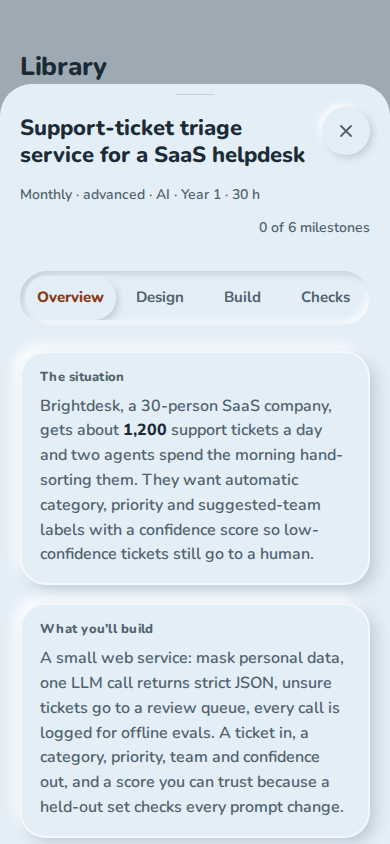
  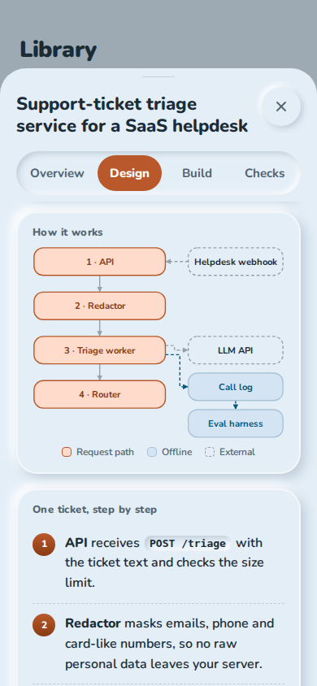
  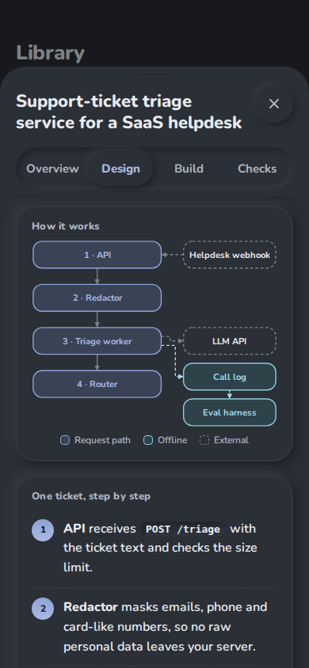
</p>

The doc is one tap away: any project card or row opens it in a sheet, in the Deck (before Take it; the doc has Take
it too), the Library, Plan › Projects, the monthly queue and the weekly slot. On Today, the project's title on the
Now card, a quiet **Tech doc** next to Start, and a project's Later today row (with "Work on it now")
open it over Today. The timer keeps running, in a pill at the top of the doc; ticks made in the doc show on the
card at once; closing it leaves Today as it was; and each doc reopens where you left it. Enter or Space opens a doc
from a focused row, Escape closes it and puts focus back. Challenges open their own screen instead.

<p>
  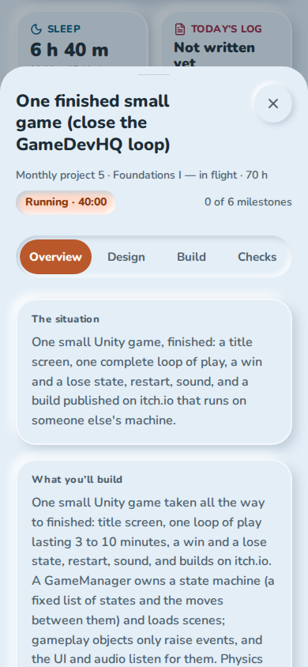
</p>

## Projects: daily, weekly, monthly

Besides the curriculum's own projects, Atlas carries a catalogue of 920 in three tiers (`data/projects/*.jsonl`):

| Tier | What | Where it shows |
|---|---|---|
| Daily | 254 easy coding challenges, 30 topics | Block B: on its Now card, and mentioned on its row |
| Weekly | 112 medium challenges and 250 medium builds | Block D's weekly slot (the weekend by default): the week's challenge, and a build you take |
| Monthly | 304 advanced real cases | Block D's monthly queue, next to the plan's monthly projects |

<p>
  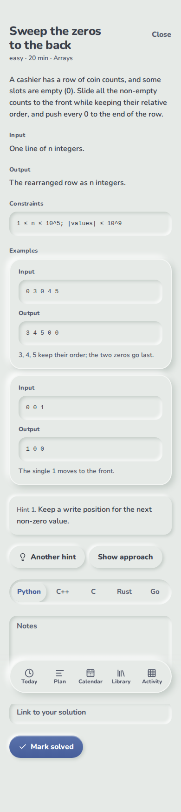
  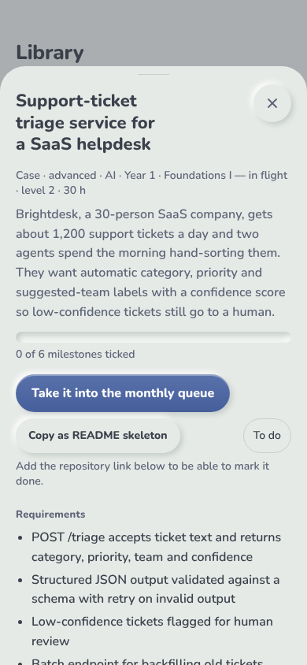
  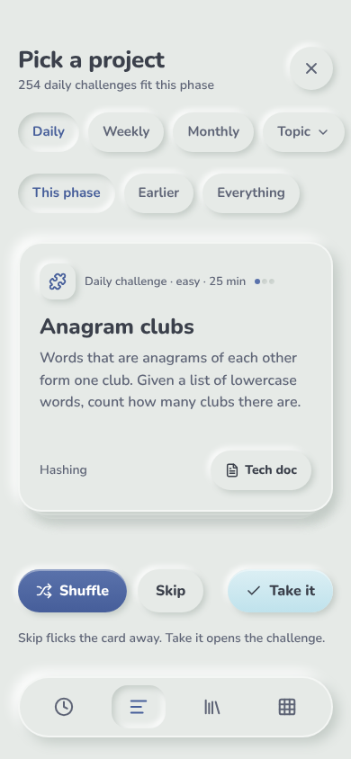
</p>

- **The daily challenge** is picked for the date from the challenges not solved yet, a new topic after each solve, in
  the language of Block B's course. Skip gives another (three a day), Not today hides it, and Settings › Projects
  turns it off. Once all 254 are solved they come round again, to solve in another language. Its streak is its own.
- **A challenge** shows the statement, input and output, constraints and examples; hints one at a time; Show approach
  for the approach, complexity and edge cases; notes, a link to your solution, and Mark solved.
- **A build or a case** opens its tech doc (above). README skeleton starts its repository; it is done only with the
  repository link filled in.
- **Finding one**: the Deck (Plan › Pick a project) by Daily, Weekly or Monthly, topic or domain, and This phase,
  Earlier or Everything; Library › Projects with search and filters for kind, difficulty, topic or domain, track,
  phase, level and hours; Activity › Projects for what is done per tier and domain and each topic's solve rate.

`npm run map:catalogue` fills each item's `refs` (courses) and `covers` (roadmap nodes) from the reviewed keyword
table in `scripts/lib/catalogue-mapping.ts`; CI checks the files match it.

## Keyboard

| Key | Does |
|---|---|
| `t` | Go to Today |
| `r` | Go to the Plan |
| `/` | Search: the page's own search box, or the Library's |
| `c` | Calendar |
| `?` | List the shortcuts |

They never fire while you type, or with Ctrl, Alt or Cmd held, and Settings > Keyboard turns them off, for
anyone using speech input. In the heatmap, Tab lands on one day, the arrow keys move by a day or a week, and
Enter opens it. The heatmap shows the whole year, January to December: the days still ahead are faint outlines,
today has an ice ring, and a tick marks the day the plan began. On a phone it opens with this week two thirds across;
All years shows each year as twelve months.

## Deploy

Pushing to `main` builds and deploys to GitHub Pages (`.github/workflows/deploy.yml`). One-time setup in
the repository: **Settings > Pages > Build and deployment > Source = "GitHub Actions"**.

The deploy checks itself (`scripts/live-check.ts`): before deploying, a browser opens the live site as a returning
user on the old build; after it, the app's update prompt must appear, Reload must bring in the new version (its
service-worker cache), and the main screens must render without an error. If not, the deploy run fails.

On a device, the new version downloads in the background and a pill above the tab bar, on every screen, offers
Reload once it is in. The app asks the site for a newer version when it opens and when it comes back into view,
and tries a failed download again a little later. Settings > "Atlas on this device" names the build the device
runs, checks for updates on demand (saying which file failed, when one did) and can drop the offline copy and
reload from the site, which keeps your data: it lives in the browser's database, not the cache.

## GitHub Sync (optional)

Off until you connect it. With it on, a private GitHub repository is where your log and progress live, and the
browser keeps a copy that works offline. Clearing the browser or changing devices loses nothing, and every
study session is a commit on your contribution graph.

<p>
  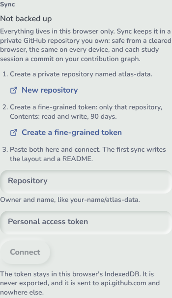
  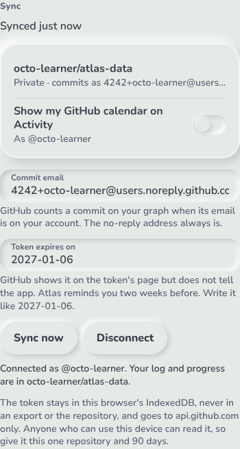
</p>

**Setting it up** (Settings > Sync):

1. [Create a private repository](https://github.com/new) named `atlas-data`. Leave it empty or add a README.
2. [Create a fine-grained personal access token](https://github.com/settings/personal-access-tokens/new):
   - Repository access: only select repositories, then `atlas-data`.
   - Permissions: Contents, read and write. Nothing else.
   - Expiration: 90 days.
3. Paste the repository (`your-name/atlas-data`) and the token into Settings > Sync, then Connect. Atlas checks
   both with GitHub, then runs the first sync. An empty repository gets a README and the whole layout. A
   repository another device already uses is merged with what this browser has.
4. Type the token's expiry date into "Token expires on". GitHub shows it on the token's page but does not let
   the app read it. Atlas reminds you two weeks before.

On another device, connect the same repository: the first sync brings everything over.

**What ends up in the repository.** Plain JSON and Markdown, readable on GitHub and editable by hand; the
README that Atlas writes into it explains each file.

| Path | What is in it |
|---|---|
| `state/items.json` | Status, ticked units, notes and links of every course, book, project, paper, certificate and milestone |
| `state/plan.json` | Your plan edits (an ordered list of patches, version 2), items of your own, re-plans and picked builds |
| `state/settings.json` | Blocks, day templates, the weekly pattern, date ranges, day changes, pace, pauses and layout (version 2). Never the token. |
| `state/practice.json` | Only in repositories from before Practice was removed (pull request #6): the practice answers of that time. Archived: Atlas no longer reads, rewrites or deletes it. |
| `state/challenges.json` | Catalogue challenges solved (and in which language), skipped or hidden for a day. Merged the same way. |
| `log/YYYY/MM/YYYY-MM-DD.json` and `.md` | One day, and its human-readable twin |
| `reviews/` | Weekly, monthly and quarterly reviews |
| `projects/` | Each project's write-up, links and checklist |
| `research/` | Your research reports. Atlas never writes here. |

**How it behaves.**

- Every change is saved in the browser first, so the app never waits for the network.
- Changes go to GitHub in one commit per sync: 3 seconds after a block or item is marked done, a timer stops or
  a review is saved; otherwise 60 seconds after the last change; and when you leave the page. Commit messages
  read like `log: 2026-10-07 · 8 h 10 m · 5/5 blocks`.
- Atlas checks GitHub when it opens and every 5 minutes while it is on screen.
- When two devices changed the same day, their entries are merged, and the later edit of each entry wins.
  Settings and plan edits keep the newer version, with a short notice.
- Offline, changes wait. Settings says how many ("Offline, 3 changes waiting"), and so does a quiet line at the
  foot of Today when they have been waiting a while. There are no banners.
- Commits are authored with your GitHub no-reply address, so they count on your graph; Settings can change it.
- **Disconnect** forgets the token and the repository, and keeps everything in the browser and on GitHub.
  **Reset everything**, with Sync on, clears only this browser; the next sync brings it back.

**The token** stays in this browser's IndexedDB. It is never exported, never written to either repository, and
sent only to `api.github.com`. Anyone who can use the device could read it, which is why it should reach only
this one repository and expire after 90 days. The calendar switch in Settings > Sync uses the same token to draw
your real GitHub contribution calendar under the Atlas heatmap on Activity.

**Checking it against the real GitHub.** `npm run test:sync` runs one full cycle with two in-memory devices:
connect, write, flush, a second device pulls, both edit the same day, merge. It works on a throwaway branch of a
repository you name, which it creates and deletes, and reads the token from the environment:

```bash
ATLAS_SYNC_TOKEN=github_pat_... npm run test:sync -- --repo your-name/atlas-sync-test
```

Use a throwaway repository with at least one commit, and a token for that repository only. `--fake` runs the
same cycle against the in-memory GitHub of the tests, and `--keep` leaves the branch for a look at its commits.

**Without Sync**, Settings says "Not backed up", once, and nowhere else. Export a file now and then (Settings >
Export everything). `npm run log:export` still turns a backup into a public Markdown learning log
(`learning-log/YYYY/MM/DD.md`, reflections left out unless you add `--reflections`).

## Editing the curriculum

Everything you study lives in `data/`, as YAML. Nothing about it is hard-coded in the app, and your logs,
statuses and notes reference items by id, so editing the curriculum never loses them.

| File | What is in it |
|---|---|
| `data/phases.yaml` | The six phases, and the focus of each lane in each |
| `data/plan.yaml` | Which item sits in which lane of which phase, in order |
| `data/resources/*.yaml` | Courses, books, lecture series and repositories |
| `data/units/*.yaml` | The lecture, chapter and lab checklist of one resource (the file name is its id) |
| `data/units/*.json` | A lesson checklist by module, with video and notes links (see Lesson checklists) |
| `data/projects/*.yaml` | Capstones, monthly builds and the weekly mini-build pool |
| `data/papers.yaml`, `data/paper-sources.yaml` | The reading queue, and where to find more |
| `data/certs.yaml`, `data/subjects.yaml` | Certifications, and the credential map |
| `data/roadmaps.yaml` | The five roadmap.sh roadmaps, as sections of nodes, each section with the phase that teaches it |
| `data/settings.yaml` | The defaults a fresh install starts from |
| `data/projects/docs/*.md` | One tech doc per project (the file name is the project's id) |
| `data/projects/design/*.yaml` | One design per case, build and documented plan project: overview, learn, components, flow, interface, decisions, watch-out (`node scripts/check-design.ts [id]` checks one) |
| `data/projects/*.jsonl` | The project catalogue: daily easy challenges, weekly medium challenges and builds, monthly real cases, one per line |

### Adding a course, step by step

1. Describe it in the file of its track, for example `data/resources/math.yaml`:

   ```yaml
   - id: my-probability-book          # unique across resources, projects, papers and certs
     title: "A probability book you picked"
     provider: Its publisher
     type: book                        # course, lectures, book, tutorial, article, paper, repo or cert
     url: null                         # no link until you have opened it yourself...
     urlVerified: false
     searchHint: "the book's title and author"   # ...and meanwhile, what to search for
     tracks: [math]
     level: intro
     cost: paid
     estHours: 60
     prerequisites: [mit-18-06]        # never scheduled before these
     subject: math-physics             # its row in the credential map (data/subjects.yaml)
     summary: "Why it is on the list, in one sentence."
     short: "Probability"              # optional: the name lists show when the title is long
     covers: [ai-engineer/embeddings]  # optional: roadmap.sh nodes it ticks when done
   ```

   Once you have opened the page, set `url`, `urlVerified: true` and `lastVerified` to that day.

2. Put it on the roadmap: add `- { resource: my-probability-book }` to a lane of a phase in
   `data/plan.yaml`. The order of the list is the order of the lane. To spread one item over two lanes or
   two years (a book begun in year 2 and finished in year 3), list it in both places with `hours:` on each.
   For part of a course ("selected lectures"), one entry with `hours:` is enough.

3. If it has chapters or lectures to tick off, list them in `data/units/my-probability-book.yaml`:

   ```yaml
   - { id: ch-1, title: "Chapter 1: Counting" }
   - { id: ch-2, title: "Chapter 2: Conditional probability" }
   ```

   Progress is stored against these ids, so rename titles freely but keep the ids.

4. Run `npm run validate:data`, then `npm run dev` to see it.

A project works the same way in `data/projects/*.yaml`, with acceptance criteria instead of units. Anything
you would rather not put in a file can be added from the app instead (Library > a shelf > Add a resource, or Plan > a
lane > Edit > "Add to this lane"); those additions live in your browser and travel in backups.

A roadmap.sh node's id is the slug of its label in `data/roadmaps.yaml`: "Ops:Byte Ratio" is
`ops-byte-ratio`. An item that `covers` a node ticks it on Plan > Credentials > Roadmaps once the item is done.
Nodes marked `optional: true` (vendor-specific or engine-specific ones) are left out of the coverage percent.

After an edit, run `npm run validate:data`. It fails on a schema error, a duplicate id, a dangling
reference, a prerequisite cycle, an item planned before its prerequisite, or a roadmap item with no row in
the credential map. Two rules are worth knowing up front:

- **ids must be unique across resources, projects, papers and certs**, because a log entry references them
  without saying which kind it means;
- **a `covers` entry must name a real node**, written `roadmap-id/node-id`;
- **a URL is either verified or absent.** Set `url: null` with a `searchHint` rather than writing down a
  link you have not opened; the app then shows the item with a "find link" badge.
